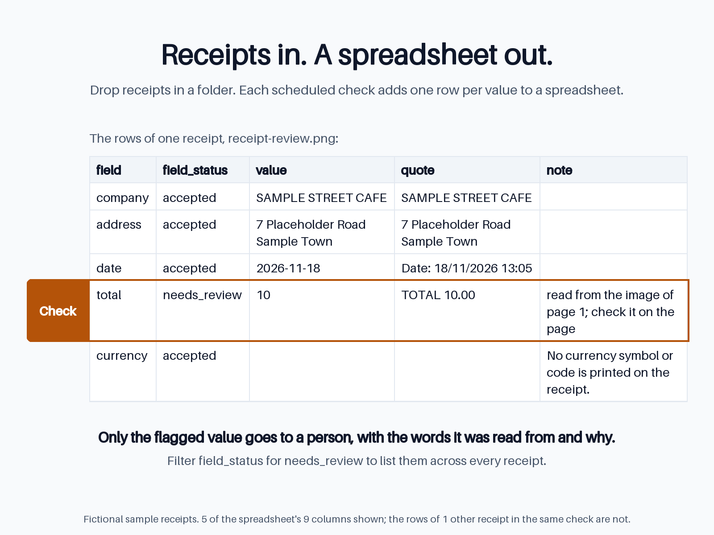

# doc-intake-pipeline

Reads receipts and invoices (scanned or photographed images, or PDFs) and returns their key fields as structured data, with every value pointing to where it was found, and anything it is unsure of flagged for a person instead of guessed.

<!-- A bare attachment link is what GitHub renders as a video player (demo/README.md). -->
<!-- markdownlint-disable-next-line MD034 -->
https://github.com/user-attachments/assets/1991ad45-b0b3-4175-8877-fd78886a157c

The voice-over is generated by AI ([demo/README.md](demo/README.md#decisions-42-the-voice-over)).

## What you get

For each document, a JSON result with company, address, date, total, currency, plus the amount before tax, the tax and any rounding, where:

- **Nothing is made up.** A field the document does not show comes back empty, with the reason.
- **Every value can be checked.** It carries the page and the exact text it was read from.
- **Doubtful values go to a person.** The result names the fields to check; everything else was accepted automatically.
- **Amounts that do not add up go to a person.** When a receipt prints the amount before tax and the tax, they must add up to the total, with any rounding, to the cent; if they do not, all of them are sent to check, so a single misread amount does not slip through. Receipts that do not print the amount before tax get no such check ([what the rule does not catch](docs/ARCHITECTURE.md#d23-regras-de-consistência-por-pacote-decidida-na-66)).
- **A broken answer never passes as a good one.** It is retried a few times, then marked as failed for review, never returned half-filled.
- **The cost of each document is logged**, with no document content in the logs.
- **It is not tied to one AI vendor.** Claude or OpenAI, chosen by a setting.

## How it runs day to day

1. **Documents land in a folder.** Save them there, or use a folder that Google Drive or Dropbox keeps in sync on the computer that runs the pipeline.
2. **The folder is checked on a schedule**, every 15 minutes in the example setup. A file still being copied or synced is left for the next check.
3. **Each check leaves a spreadsheet** that opens in Excel or Google Sheets: one row per field, with the value, the page and the exact text it was read from. Filter `field_status` to `needs_review` and you have the review queue. The person checking records each decision in the same row: confirmed, corrected (with the right value) or not on the page ([how](deploy/README.md#reviewing-a-run)). Those decisions add up to a report of how often each field was wrong, and the highest error rate the reviews so far cannot rule out. Once enough reviews show that a field read from the image is wrong less often than a target you set, that field can stop going to review, while a random sample of it still comes back to be checked ([how](deploy/README.md#accepting-image-read-fields-without-review)). The original documents are moved into the same folder as the spreadsheet, so each one is next to its rows.
4. **No document is lost.** A file that is not a readable document is listed as failed and moved with the others. One the AI provider could not answer (network, outage, a rejected request), or that changed while the check ran, stays in the folder and is tried again on every check until it goes through; meanwhile each check is marked as failed, so someone looks.

Two sample receipts, one of them with a value to check, give this review queue:

| file | field | field_status | value | quote | note |
| --- | --- | --- | --- | --- | --- |
| receipt-review.png | total | needs_review | 10 | TOTAL 10.00 | read from the image of page 1; check it on the page |

The other fifteen rows (both receipts' remaining fields) are `accepted`, eight of them empty with the reason, since the sample receipts print no currency or tax. To see it yourself, run `uv run poe inbox-demo` (no API key, no cost).

## How well it works

<!-- eval-summary:start (written by `uv run poe eval --update-readme`) -->
Measured on 20 public scanned receipts, 160 values in all (company, address, date, total, currency, net, tax, rounding):

- **157 of 160 correct.**
- **93 accepted automatically**, none of them wrong.
- **40 sent to a person to check**, 3 of them wrong.
- **27 left empty**, with the reason.
- **$0.79 for the whole set**, about $0.04 per receipt.
<!-- eval-summary:end -->

On invoices (number, dates, seller, subtotal, tax, total, currency):

<!-- eval-summary:fatura:start (written by `uv run poe eval --suite fatura --update-readme`) -->
Measured on 20 public template-generated invoices, 180 values in all (number, date, due_date, seller_name, seller_address, subtotal, tax, total, currency):

- **180 of 180 correct.**
- **115 accepted automatically**, none of them wrong.
- **34 sent to a person to check**, none of them wrong.
- **31 left empty**, with the reason.
- **$0.63 for the whole set**, about $0.03 per invoice.
<!-- eval-summary:fatura:end -->

These invoices are generated from templates (clean pages, one date format), so they are easier than real ones: read this as "the invoice fields work", not as the accuracy to expect on your invoices ([why](docs/DATA.md#fatura-golden-set-invoice-pack-69)).

A wrong value should be caught by review, not reach you unchecked, so every change to the code is re-measured on these receipts and invoices and blocked if it gets more answers wrong or accepts a wrong value without review. Evidence: the full report of every run is in the eval job summary of the [CI runs on `main`](https://github.com/brunoccalmeida/doc-intake-pipeline/actions/workflows/ci.yml?query=branch%3Amain); how values are scored is in [How it is measured](docs/DEVELOPMENT.md#eval).

## What it does not do yet

- **Receipts and invoices.** Invoices are read one at a time for now (`uv run poe extract --pack invoice <file>`); the folder-to-spreadsheet run reads receipts. Another document type (purchase orders, IDs, forms) means a new field list and a new test set of that type, measured the same way. Invoice line items and the buyer are not read yet.
- **The numbers above come from public documents:** receipts from one country and period (Malaysia, 2016 to 2018), and invoices generated from templates as clean digital pages, not scans. They show the pipeline does not get worse; they do not predict accuracy on your documents, which would be measured on a sample of them ([known limitations](docs/DATA.md#known-limitations)).
- **English text only**, for now.
- **Review happens in the spreadsheet.** There is no review screen yet, and a correction made in the sheet is not sent back to the pipeline.
- **A folder in, a spreadsheet out.** Email inboxes and business systems (QuickBooks, NetSuite and the like) are connected per project; that code is not in this public repository. There is no web API or user interface yet.

## For developers

Setup, commands, configuration, the eval and the data: [`docs/DEVELOPMENT.md`](docs/DEVELOPMENT.md). Design decisions and their alternatives: [`docs/ARCHITECTURE.md`](docs/ARCHITECTURE.md).

## License

MIT
